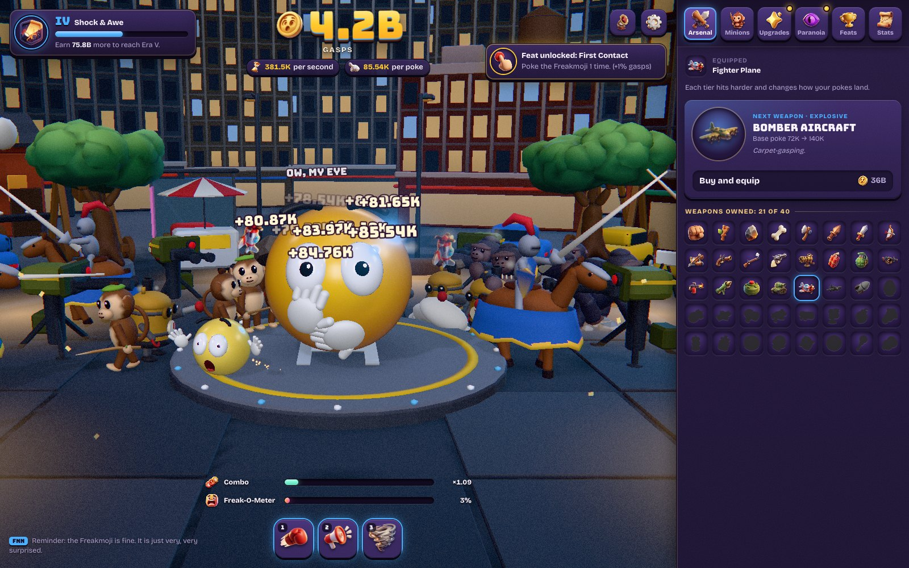
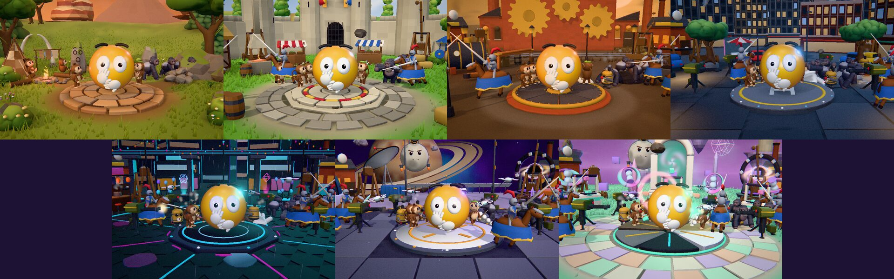

<p align="center">
  
</p>

<p align="center">
  <a href="https://github.com/nlaratta/emoji-clicker/actions/workflows/ci.yml"></a>
  <a href="LICENSE"></a>
  <a href="https://nlaratta.github.io/emoji-clicker/"></a>
</p>

An incremental arcade game about one very startled emoji. Poke the 3D Freakmoji to make it gasp, arm yourself with forty weapons from bare fists to a galaxy destroyer, recruit minions that bombard it for you, shatter its composure at every era gate, and keep going until reality itself breaks. Then collapse the timeline and do it again, more paranoid.

**[▶ Play it in your browser](https://nlaratta.github.io/emoji-clicker/)**, or find it with my other games on the [Game Hub](https://nlaratta.github.io/game-hub/).

<p align="center">
  
</p>

## What's in it

- **A real 3D star.** The Freakmoji is modelled procedurally: it dents where you hit it, squashes and stretches, tracks your cursor, blinks, and flinches its gloves away to gasp. Each weapon family (blunt, blades, arrows, bullets, explosives, fire, energy, cosmic, reality) lands its own way.
- **A world that evolves.** Seven eras, each a diorama that rises out of the ground as the last one sinks: Stone Age dusk, a castle siege, a smoggy factory yard, a night city, a synthwave grid, deep space on an asteroid, and a reality that has stopped making sense.
- **Active and idle play.** Combos, critical pokes, glowing weak spots to aim at, a Freak-O-Meter that triggers Freak Outs, golden Freakmojis to catch, and five abilities including a hold-and-release Haymaker with a perfect-timing window. Fourteen minion types keep earning while you watch or while you're away.
- **Bosses and prestige.** Each era is guarded by a "Composure" boss you have to out-gasp in 30 seconds. Collapse the timeline for Paranoia, then spend it in a three-branch tree (Twitchy, Brooding, Unhinged) or keep it as a multiplier.
- **Procedural sound.** Every sound and all the music are synthesised in the browser with Web Audio. Pokes play in the key of the era's music and climb as your combo builds.

<p align="center">
  
</p>

## Controls

| Action | Mouse / touch | Keyboard |
|---|---|---|
| Poke | Click or tap the Freakmoji | Space or Enter |
| Abilities | Hotbar buttons (hold Haymaker) | 1–5 (hold 1) |
| Catch a golden Freakmoji | Click it | G |
| Challenge a boss | Challenge button | B |
| Mute | 🔊 button | M |

Settings cover volume, graphics quality (auto-adapts by default), reduced motion, screen flashes, screen shake, number notation, and save export/import.

## Quick start

Requires Node 22+ and pnpm (via Corepack).

```bash
git clone https://github.com/nlaratta/emoji-clicker.git
cd emoji-clicker
corepack enable && pnpm install
pnpm dev        # http://localhost:5173
```

| Command | What it does |
|---|---|
| `pnpm build` | Typecheck and build to `dist/` |
| `pnpm test` | Unit tests: economy, simulation, saves, architecture |
| `pnpm e2e` | Playwright tests against the production build under `/emoji-clicker/` |
| `pnpm perf` | Per-era frame profile against the dev server: GPU time, JS time, draw calls and triangles, with each subsystem switched off in turn (`--tier=`, `--soft` for software rendering like CI) |
| `pnpm balance [hours]` | Simulates bot playstyles and writes [`docs/balance.md`](docs/balance.md) |
| `pnpm screenshots` | Regenerates the README images (needs `pnpm dev` running) |

## How it works

- `src/sim/` is the game: a deterministic, seeded simulation in plain TypeScript with no DOM or Three.js imports (a test enforces this). It advances in fixed steps, splits long gaps exactly at timer boundaries, and emits events.
- `src/content/` holds the data: eras, weapons, minions, upgrades, abilities, the Paranoia tree, achievements and news headlines. All prices come from formulas, so every tier has a finite cost.
- `src/render/` is the Three.js presentation (character, era worlds, particles, minions, post-processing). It reads state and reacts to events but never changes game state.
- `src/audio/` is the Web Audio engine; `src/ui/` is the HUD and shop.
- Saves are versioned JSON in `localStorage` with a checksum and a backup slot; corrupt or hand-edited saves are repaired field by field. Offline time pays out at 25% for up to 2 hours (Paranoia raises both). Only one tab plays at a time. High scores from the original version of the game are imported into the Stats tab.
- Numbers are plain doubles: content tops out far below `1e300`, and every economy value passes through a finite-number guard.
- Pushes to `main` run typecheck, unit tests, build and Playwright in CI, then deploy `dist/` to GitHub Pages.

## Credits

The 3D eras, props and minions are procedural Blender models built by the scripts in `art/blender/`; the icons were illustrated with a locally run image model (Krea 2 Turbo) from the prompts in `art/icons/`; sound is synthesised in code. See [docs/art-direction.md](docs/art-direction.md). Fonts: [Bungee](https://github.com/djrrb/Bungee) and [Bricolage Grotesque](https://github.com/ateliertriay/bricolage), both under the SIL Open Font License, bundled via Fontsource. Built with [Three.js](https://threejs.org/) (MIT) and [Vite](https://vite.dev/).

## License

[MIT](LICENSE) © Noah Laratta
