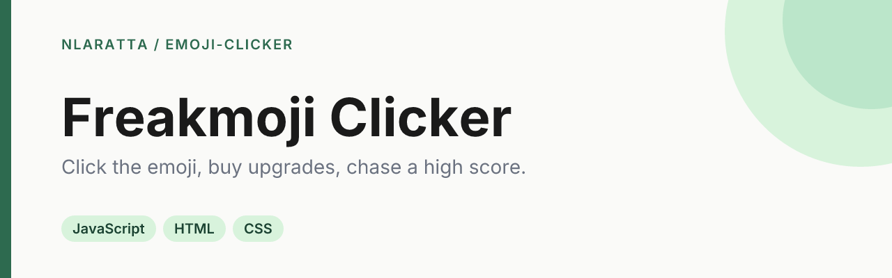
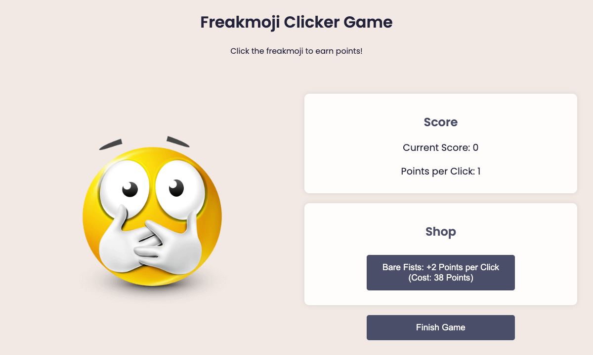

<p align="center">
  
</p>

<p align="center">
  <a href="https://github.com/nlaratta/emoji-clicker/actions/workflows/ci.yml"></a>
  <a href="LICENSE"></a>
  <a href="https://nlaratta.github.io/emoji-clicker/"></a>
</p>

A small clicker game. Click the freakmoji to earn points, spend them on a long ladder of upgrades (from Bare Fists to the Railgun and beyond), then finish the game to post a top-10 high score.

**[▶ Play it in your browser](https://nlaratta.github.io/emoji-clicker/)**, or find it with my other games on the [Game Hub](https://nlaratta.github.io/game-hub/).

<p align="center">
  
</p>

## Quick start

It's plain HTML, CSS and JavaScript with no build step:

```bash
git clone https://github.com/nlaratta/emoji-clicker.git
cd emoji-clicker
python3 -m http.server 8000   # then open http://localhost:8000
```

Opening `index.html` directly also works.

## How it works

- `js/upgrades.js` defines the upgrade ladder. Each tier costs more and adds more points per click.
- `js/game.js` holds the game state, click handling, the shop and the end-of-game flow.
- High scores are saved in your browser's `localStorage`.
- Pushes to `main` run CI (a script syntax check and an asset check) and deploy to GitHub Pages.

## License

[MIT](LICENSE) © Noah Laratta
